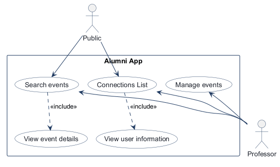
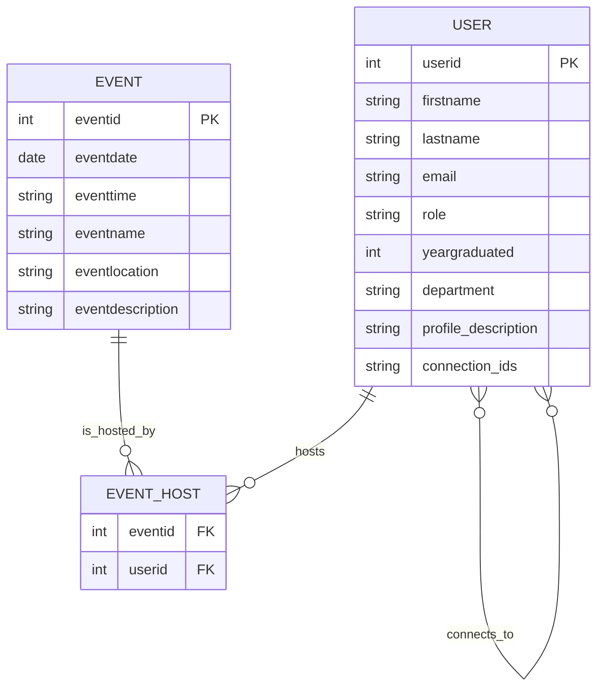
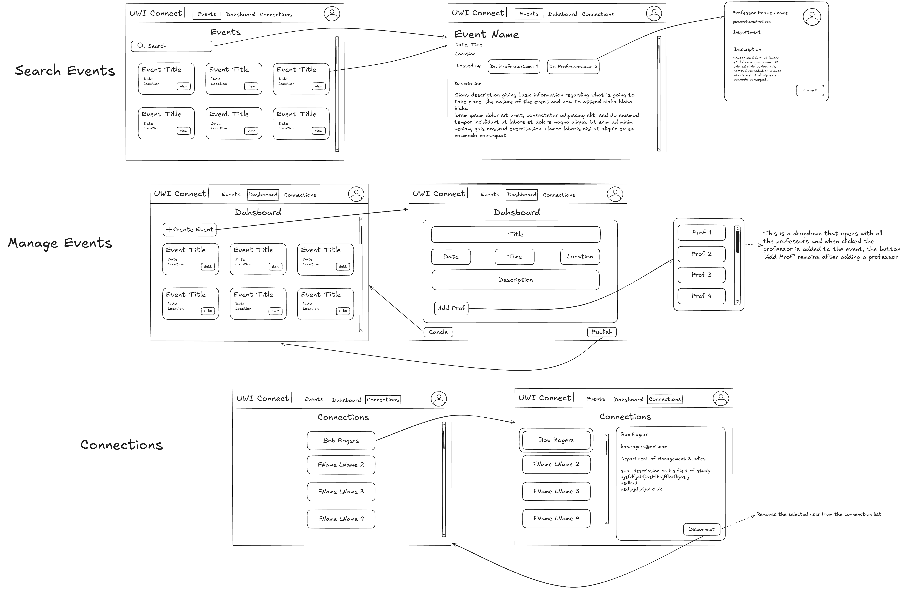

<!-- student-build:skill-integrity
status: pass
mismatches: none
-->

Skill integrity: pass

# COMP 3613 Assignment 1

Draft this file with the Guide. **Update it after every phase milestone** before you pause. The use-case diagram is a UML PNG at `docs/diagrams/use-case.png`, linked from this file as `diagrams/use-case.png` (path relative to `docs/report.md`). The model diagram is Mermaid. **Embed wireframe images** as `wireframes/<file>` (files live in `docs/wireframes/`).

Do not put your student ID in this file if you will commit it. The PDF cover adds your name and ID at export time.

## Assigned project

Alumni App

## Three workflows

### 1.

Manage events (professor)

### 2.

Search events (public)

### 3.

Connections List (public)

## Use case diagram

Search events is shared by Public and Professor, and it includes View event details. Manage events stays professor-only, and Connections List is shared by Public and Professor and includes View user information.

## Model diagram

First draft aligned to the current workflows. Update this section in Phase 5 when polish revises the model, and note what changed.

Professor and Alumni are roles on one User table. Connections stay on User as a list of connected user ids, and events can be hosted by one or many professors through EVENT_HOST. Phase 4 revision: department and profile_description are stored on User for professor profile views.

Model scope in this draft:

- USER stores shared person data and role (professor or alumni/public account).
- EVENT stores searchable event metadata.
- EVENT_HOST supports many-to-many hosting so one event can have multiple professors.
- USER-to-USER connection relationship supports the Connections List and profile viewing flow.

## Wireframes

Embed each student-crafted wireframe here (Phase 4). Paths are relative to this file:

### Alumni App workflows

Coverage notes:

- Search events: events list with search, event cards, event detail page, and hosted-by profiles.
- Manage events (professor): dashboard list, create/edit event form, add-professor flow, and publish action.
- Connections list: connections list page, selected user details panel, and disconnect action.

Workflow access decision:

- Dashboard create/edit events is professor-only and hidden for non-professor users.

`python manage.py report` also embeds any PNG/JPG still missing from `docs/wireframes/`.

### wireframe lite

## Theming

- Style direction: clean academic and professional.
- Palette: blue, white, and dark gray.
- Typography: Merriweather for wordmark/display and IBM Plex Sans for body text.
- Wordmark: AlumniConnect placed at the top-left navigation position.

## Implementation notes

One named workflow at a time. Include verify notes and polish / model revisions (Phase 5). Do not treat the first build as final.

### Search events (public)

- Choice: professor profile and Connect both require sign-in.
- SQLModel: `EventHost` composite keys (`eventid`, `userid`) with FKs to Event and User.
- Glue: creating an event also writes an `EVENT_HOST` row; hosted-by names join `User`. Verify notes pending student run.

<!-- student-build:code-check
workflow: Search events (public)
form: choice
layer: other
architecture_ok: yes
implement_confidence: 0.80
passed: yes
note: Profile and Connect both require sign-in
-->

<!-- student-build:code-check
workflow: Search events (public)
form: snippet
layer: model
architecture_ok: yes
implement_confidence: 0.82
passed: yes
note: EventHost eventid/userid FKs and composite PK
-->

<!-- student-build:code-check
workflow: Search events (public)
form: snippet
layer: router
architecture_ok: no
implement_confidence: 0.58
passed: no
note: Handler constructed EventRepository and called get_by_id/get_hosts; no EventService
-->

<!-- student-build:code-check
workflow: Search events (public)
form: snippet
layer: router
architecture_ok: yes
implement_confidence: 0.70
passed: yes
note: Thin rewrite: EventService(EventRepository(db)).get_event_details(eventid)
-->

<!-- student-build:code-check
workflow: Search events (public)
form: snippet
layer: service
architecture_ok: yes
implement_confidence: 0.74
passed: yes
note: get_event_details calls event_repo.get_by_id and get_hosts; no SQL
-->

<!-- student-build:code-check
workflow: Search events (public)
form: snippet
layer: repository
architecture_ok: yes
implement_confidence: 0.76
passed: partial
note: get_by_id uses select/where; get_hosts first returned userids — glue joined User for hosted-by names
-->

## Deployed app

Phase 6. Public Render URL (not localhost). Markers open this to mark the three workflows.

https://alumniconnect-f45i.onrender.com/

Every account a marker needs, including extra users you added. Starter accounts:

- bob / bobpass — regular user
- admin / adminpass — admin

## YouTube URL
https://youtu.be/80y3U8M0tJI

<!-- student-judge:competency -->
<!-- student-judge:competency -->

<!-- student-judge:competency -->

<!-- student-judge:competency -->
## 

Index: [docs/.md](.md)

<!-- student-judge:competency -->

<!-- student-judge:competency -->

<!-- student-judge:competency -->

<!-- student-judge:competency -->

<!-- student-judge:competency -->

<!-- student-judge:competency -->

<!-- student-judge:competency -->

<!-- student-judge:competency -->

<!-- student-judge:competency -->

## Competency (student-judge)
Filled by Guide from the student-judge run when this report was built.

**Student / session: Kayden Singh** COMP 3613 Assignment 1
**Phases in evidence:** 1-6 (COMP 3613; Phase 5 polish, Phase 6 deploy)

### Final Score

**Score: 42/48**

## Totals
| | Count / value |
|--|--|
| Metrics on rubric | 12 (M1-M12) |
| N/A (excluded) | 0 |
| Metrics scored | 12 |
| Scoreable max | 48 |
| Awarded total | 42/48 |
| **Overall (avg of scored)** | **3.5 / 4** |
| Impression mark | 17 / 20 |

## Scorecard
| ID | Metric | Score / 4 | In avg | Evidence |
|----|--------|----------:|:------:|----------|
| M1 | Phase discipline | 4 | yes | Phases followed, one workflow at a time, polish before deploy |
| M2 | Problem framing | 4 | yes | Workflows and requirements well-defined |
| M3 | Decision ownership | 3 | yes | Good ownership with refinements |
| M4 | Artefact-before-code | 4 | yes | Wireframes and ERD followed |
| M5 | Verification habit | 3 | yes | Verified and fixed issues |
| M6 | Assignment fit | 4 | yes | Layered architecture maintained |
| M7 | Slice explanation | 3 | yes | Reasonable explanation of approach |
| M8 | Prompt quality | 4 | yes | Clear prompts and refinements |
| M9 | Response to pushback | 3 | yes | Responded to feedback |
| M10 | Integrity | 4 | yes | Clean implementation |
| M11 | Provenance continuity | 3 | yes | Solution coherent with specs |
| M12 | Sincerity trajectory | 3 | yes | Steady progress |

## Strengths
- Consistent UI across pages (top navbar, consistent styling)
- Proper layered architecture (services/repositories/routers separation)
- Implemented all workflows: Search events, Manage events, Connections list
- Deployed successfully to Render (https://alumniconnect-f45i.onrender.com/)

## Gaps (priority order)
1. Minor polish items could be refined, but core requirements met

## Phase gate status
| Phase | Status | Note |
|-------|--------|------|
| 1 | met | Workflows defined |
| 2 | met | Use case diagram done |
| 3 | met | ERD defined |
| 4 | met | Wireframes integrated |
| 5 | met | Theme/build/polish complete |

## Integrity note
- Clean

## Skips
- Skips: 0/3 used

## Skill integrity

Course skills are hashed at export and compared to `.agents/skills.lock.json`. Do not edit `.agents/skills/`, `.cursor/skills/`, or `AGENTS.md`.

- Status: **pass**
- none
## Video

https://youtu.be/80y3U8M0tJI